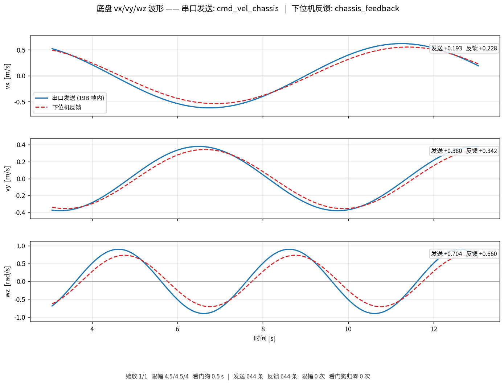

# debug_tools —— 现场排查用的小工具

这里放的是**调试期**用的一次性脚本：不参与 `colcon build`，没有 `package.xml`，
不改导航链路，不往 `/cmd_vel_*` 上写任何东西。每个工具都尽量做成
"读完能自己判断故障在哪一层"，而不是只把数字打出来。

| 工具 | 用途 | 状态 |
| --- | --- | --- |
| `plot_vxvywz.py` | 底盘 vx/vy/wz 波形：串口发送 + 下位机反馈，共 6 条曲线 | 可用（反馈侧接口预留） |

---

## 1. `plot_vxvywz.py` —— vx/vy/wz 波形



> 上图是 `--demo` 的合成数据：蓝实线 = 串口发送（19 字节帧内的值），
> 红虚线 = 下位机反馈。演示数据里刻意加了跟随增益和约 0.15 s 的滞后，
> 真实反馈接上之后两条线的差就是这一路的跟随误差。

一张图三行，每行一个通道；每行两条线：

| 通道 | 蓝实线（串口发送） | 红虚线（下位机反馈） |
| --- | --- | --- |
| `vx` | 19 字节帧里 `speed_vector.vx` 的**实际数值** | 下位机回传的实测 vx |
| `vy` | 同上，`vy` | 实测 vy |
| `wz` | 同上，`wz` | 实测 wz |

### 1.1 蓝线是怎么来的（重要）

工具**不打开串口**（端口被 `srm27_nav_protocol` 独占），而是订阅它的唯一输入
`cmd_vel_chassis`，然后按节点内部 `fillSpeedVector()` 的顺序**复算**出真正写进帧的值：

```text
看门狗（cmd_timeout_sec 内没更新 -> 三个分量一起归零，协议 §6.3）
  -> 乘缩放系数（linear_velocity_scale / angular_velocity_scale）
  -> 按 max_vx / max_vy / max_wz 逐轴限幅（协议 §6.5）
  -> 写进 19 字节帧
```

所以蓝线 = 下位机那一帧实际收到的数字。这四个参数**默认直接读**
`src/srm27_nav_protocol/config/srm27_nav_protocol.yaml`，改 yaml 不用改脚本；
命令行也留了覆盖开关（`--max-vx` / `--linear-scale` / `--cmd-timeout` ...）。

> 这是"按节点逻辑复算"，不是逐字节抓串口。要看原始字节，把 yaml 里
> `debug_print_hex` 打开（注意它会影响定频心跳，见协议 §6.6），
> 或者后续在这里加一个串口嗅探工具。

### 1.2 红线（下位机反馈）为什么现在是空的

《SRM 校内赛导航通信协议》里下→上只有 `0x0001`（比赛状态，11 B）和
`0x000B`（机器人状态，13 B），**两个包里都没有 vx/vy/wz**，所以固件目前
没有速度回传。工具把接口先留好：

- 默认订阅 `chassis_feedback`（相对名，随 `__ns` 走；`geometry_msgs/msg/Twist`）；
- `--feedback-type odom` 可以改读 `nav_msgs/msg/Odometry` 的 `twist`；
- 图上会显示"下位机反馈接口预留：等待 ..."，不影响蓝线。

**固件加了这个包之后怎么接**（两种都不用改本脚本）：

1. 在 `srm27_nav_protocol` 的接收 `switch (cmd_id)` 里解析新包，
   组一个 `Twist` 发到 `chassis_feedback`（或 `~/chassis_feedback`，用绝对名传 `--feedback-topic`）；或
2. 直接把新包转发成 `Odometry`，然后 `--feedback-type odom --feedback-topic <话题>`。

顺带提醒：接反馈时**别把发送值原样回传**，否则"指令 vs 实际"就没有对照意义了；
回传底盘测出来的真实线速度/角速度才有用。

### 1.3 用法

```bash
source /opt/ros/humble/setup.bash
source install/setup.bash            # 只用到标准消息时可以省

# 默认：cmd_vel_chassis + chassis_feedback
./debug_tools/plot_vxvywz.py

# 带命名空间（两种写法都认）
./debug_tools/plot_vxvywz.py --ros-args -r __ns:=/red_standard_robot1
./debug_tools/plot_vxvywz.py -r __ns:=/red_standard_robot1

# 时间窗 60 s，同时录 CSV
./debug_tools/plot_vxvywz.py --window 60 --csv /tmp/vxvywz.csv

# 跑 30 s 自动退出并存图（不需要人守着关窗口）
./debug_tools/plot_vxvywz.py --duration 30 --save /tmp/vxvywz.png

# 没有显示器 / ssh 上去
./debug_tools/plot_vxvywz.py --headless --duration 20 --save /tmp/vxvywz.png

# 先验证画图链路本身（不连 ROS，用合成数据）
./debug_tools/plot_vxvywz.py --demo --duration 10 --save /tmp/demo.png
```

### 1.4 参数

| 参数 | 默认 | 说明 |
| --- | --- | --- |
| `--send-topic` | `cmd_vel_chassis` | 串口节点的输入话题（相对名，跟随 `__ns`） |
| `--feedback-topic` | `chassis_feedback` | 下位机反馈话题（相对名，随 `__ns`；当前是预留） |
| `--feedback-type` | `twist` | `twist` = `geometry_msgs/Twist`；`odom` = `nav_msgs/Odometry` |
| `--config` | `src/srm27_nav_protocol/config/srm27_nav_protocol.yaml` | 读限幅/缩放/看门狗的来源 |
| `--max-vx` `--max-vy` `--max-wz` | 读 yaml | 覆盖限幅值 |
| `--linear-scale` `--angular-scale` | 读 yaml | 覆盖缩放系数 |
| `--cmd-timeout` | 读 yaml | 覆盖看门狗超时 |
| `--window` | `20` | 波形时间窗（秒） |
| `--sample-hz` | `50` | 采样记录频率（串口 100 Hz 发，50 Hz 足够看形状） |
| `--plot-hz` | `20` | 界面刷新频率 |
| `--duration` | `0` | 运行时长，0 = 一直跑到关窗口 / Ctrl-C |
| `--csv` | 空 | 录 CSV：`t_elapsed,t_wall,s_vx..,f_vx..,watchdog,clamped` |
| `--save` | 空 | 退出时存 PNG |
| `--demo` | 关 | 合成假数据，不初始化 ROS |
| `--headless` | 自动 | 没有 `DISPLAY` 时自动开启（Agg 后端） |

### 1.5 图上怎么判读

- **蓝线掉到 0、底部"看门狗归零"计数 +1**：上游 0.5 s 没发新指令，串口节点
  在按协议 §6.3 重发零速帧。这是"导航停了/控制器卡了"，不是车的故障。
- **蓝线贴着 `±max_vx` 之类的水平线**：限幅生效，底部"限幅 N 次"会涨。
  注意限幅作用在缩放**之后**。
- **蓝线有、红线没有**：要么固件还没做回传（当前情况），要么反馈话题接错了。
- **红线在蓝线上一段后突然断掉**：反馈超过 `cmd_timeout_sec` 没更新，
  工具按"过期"处理（避免下位机断链后红色虚线平着无限延伸骗人）。
- **红线和蓝线的差**就是这个通道真实的"跟随误差"——这也是这个工具最主要的用途。

---

## 2. 2026-11-04 的配套改动

为了"图上看到的就是下位机收到的"，`src/srm27_nav_protocol/config/srm27_nav_protocol.yaml`
里的速度对齐系数被去掉：

```diff
-    linear_velocity_scale: 0.80
-    angular_velocity_scale: 0.8
+    linear_velocity_scale: 1.0
+    angular_velocity_scale: 1.0
```

⚠ **风险**：0.80 原本是为了抵消实测"实际速度 / 指令值 ≈ 1.263"的标定值，
去掉之后车实际会跑到指令的约 **1.26 倍**。原标定依据（2026-10-09 实车录包）
写在 yaml 注释里，改回 `0.80` / `0.8` 即可恢复，不用改代码。
第一次实车前建议把车架起来看波形，或者先把 `max_vx` / `max_vy` 调小再跑。

---

## 3. 常见问题

| 现象 | 排查 |
| --- | --- |
| 图上一条线都没有 | `ros2 topic hz cmd_vel_chassis`；命名空间是否要 `__ns`；工具启动后会打印"[就绪] 已收到 ..."或 5 s 后的提示 |
| 有 `/cmd_vel` 但没有 `/cmd_vel_chassis` | 串口节点订阅的是 `cmd_vel_chassis`，`fake_vel_transform` 那一级才是改名点（见 README 速度链路图） |
| 时间轴不动 / 从 0 开始一直不变 | 开了 `use_sim_time` 但没有 `/clock`，工具会自动退回墙钟并提示 |
| 中文显示成方块 | 缺 CJK 字体；脚本会自动挑 Noto/Droid Sans Fallback，装一个 CJK 字体即可 |
| 弹不出窗口 | 没有 `DISPLAY`：用 `--headless --save xx.png` |
| Ctrl-C 后 CSV 不完整 | CSV 每秒落盘一次；`kill -9` 仍会丢最后 1 秒，正常 Ctrl-C 不会 |
