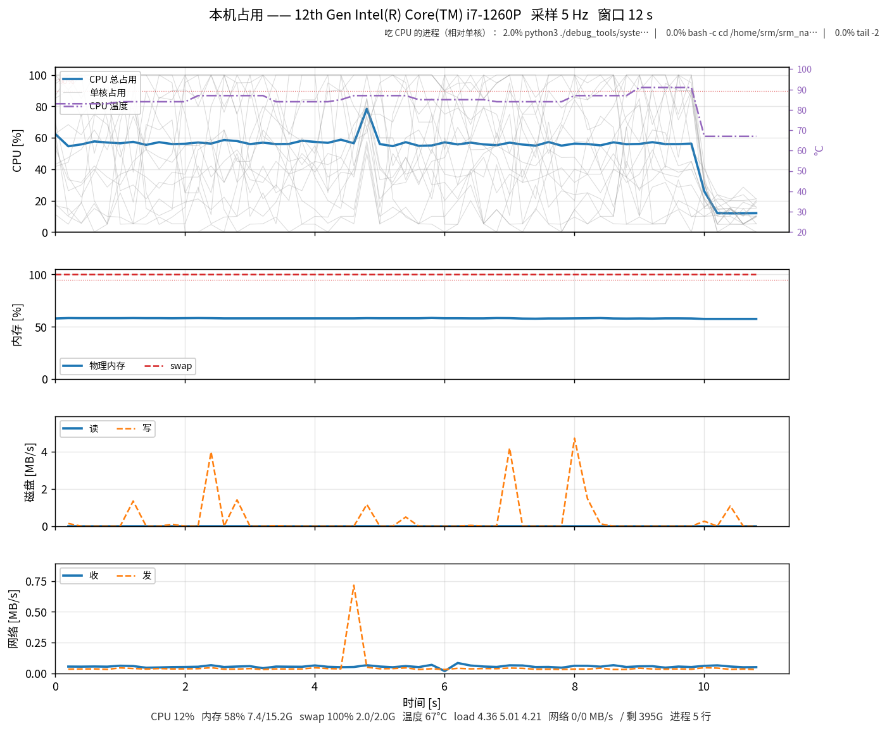

# debug_tools —— 现场排查用的小工具

这里放的是**调试期**用的一次性脚本：不参与 `colcon build`，没有 `package.xml`，
不改导航链路，不往 `/cmd_vel_*` 上写任何东西。每个工具都尽量做成
"读完能自己判断故障在哪一层"，而不是只把数字打出来。

| 工具 | 用途 | 状态 |
| --- | --- | --- |
| `plot_vxvywz.py` | 底盘 vx/vy/wz 波形：串口发送 + 下位机反馈，共 6 条曲线 | 可用（反馈侧接口预留） |
| `plot_lio_gt_yaw.py` | **LIO 算的车头朝向 vs Gazebo 真值**：yaw 曲线 + 误差 + x-y 轨迹 + 速度符号，4 个面板 | 可用 |
| `system_monitor.py` | 本机占用：CPU/内存/swap/温度/磁盘/网络 + **导航栈分组统计** + 最吃 CPU 的进程 | 可用 |

`plot_vxvywz.py` 与 `system_monitor.py` 共用 `_common.py`（matplotlib 配置目录、
中文字体、CSV 落盘、`-h` 输出），改公共行为只改那一处；
`plot_lio_gt_yaw.py` 是后加的，自带一份同样的样板，没依赖 `_common.py`。

---

## 1. `plot_vxvywz.py` —— vx/vy/wz 波形


> 上图是 `--demo` 的合成数据：蓝实线 = 串口发送（19 字节帧内的值），
> 红虚线 = 下位机反馈。演示数据里刻意加了跟随增益和约 0.15 s 的滞后，
> 真实反馈接上之后两条线的差就是这一路的跟随误差。

一张图三行，每行一个通道；每行两条线：

| 通道 | 蓝实线（串口发送） | 红虚线（下位机反馈） |
| --- | --- | --- |
| `vx` | 19 字节帧里 `speed_vector.vx` 的**实际数值** | 下位机回传的实测 vx |
| `vy` | 同上，`vy` | 实测 vy |
| `wz` | 同上，`wz` | 实测 wz |

### 1.1 蓝线是怎么来的（重要）

工具**不打开串口**（端口被 `srm27_nav_protocol` 独占），而是订阅它的唯一输入
`cmd_vel_chassis`，然后按节点内部 `fillSpeedVector()` 的顺序**复算**出真正写进帧的值：

```text
看门狗（cmd_timeout_sec 内没更新 -> 三个分量一起归零，协议 §6.3）
  -> 乘缩放系数（linear_velocity_scale / angular_velocity_scale）
  -> 按 max_vx / max_vy / max_wz 逐轴限幅（协议 §6.5）
  -> 写进 19 字节帧
```

所以蓝线 = 下位机那一帧实际收到的数字。这四个参数**默认直接读**
`src/srm27_nav_protocol/config/srm27_nav_protocol.yaml`，改 yaml 不用改脚本；
命令行也留了覆盖开关（`--max-vx` / `--linear-scale` / `--cmd-timeout` ...）。

> 这是"按节点逻辑复算"，不是逐字节抓串口。要看原始字节，把 yaml 里
> `debug_print_hex` 打开（注意它会影响定频心跳，见协议 §6.6），
> 或者后续在这里加一个串口嗅探工具。

### 1.2 红线（下位机反馈）为什么现在是空的

《SRM 校内赛导航通信协议》里下→上只有 `0x0001`（比赛状态，11 B）和
`0x000B`（机器人状态，13 B），**两个包里都没有 vx/vy/wz**，所以固件目前
没有速度回传。工具把接口先留好：

- 默认订阅 `chassis_feedback`（相对名，随 `__ns` 走；`geometry_msgs/msg/Twist`）；
- `--feedback-type odom` 可以改读 `nav_msgs/msg/Odometry` 的 `twist`；
- 图上会显示"下位机反馈接口预留：等待 ..."，不影响蓝线。

**固件加了这个包之后怎么接**（两种都不用改本脚本）：

1. 在 `srm27_nav_protocol` 的接收 `switch (cmd_id)` 里解析新包，
   组一个 `Twist` 发到 `chassis_feedback`（或 `~/chassis_feedback`，用绝对名传 `--feedback-topic`）；或
2. 直接把新包转发成 `Odometry`，然后 `--feedback-type odom --feedback-topic <话题>`。

顺带提醒：接反馈时**别把发送值原样回传**，否则"指令 vs 实际"就没有对照意义了；
回传底盘测出来的真实线速度/角速度才有用。

### 1.3 用法

```bash
source /opt/ros/humble/setup.bash
source install/setup.bash            # 只用到标准消息时可以省

# 默认：cmd_vel_chassis + chassis_feedback
./debug_tools/plot_vxvywz.py

# 带命名空间（两种写法都认）
./debug_tools/plot_vxvywz.py --ros-args -r __ns:=/red_standard_robot1
./debug_tools/plot_vxvywz.py -r __ns:=/red_standard_robot1

# 时间窗 60 s，同时录 CSV
./debug_tools/plot_vxvywz.py --window 60 --csv /tmp/vxvywz.csv

# 跑 30 s 自动退出并存图（不需要人守着关窗口）
./debug_tools/plot_vxvywz.py --duration 30 --save /tmp/vxvywz.png

# 没有显示器 / ssh 上去
./debug_tools/plot_vxvywz.py --headless --duration 20 --save /tmp/vxvywz.png

# 先验证画图链路本身（不连 ROS，用合成数据）
./debug_tools/plot_vxvywz.py --demo --duration 10 --save /tmp/demo.png
```

### 1.4 参数

| 参数 | 默认 | 说明 |
| --- | --- | --- |
| `--send-topic` | `cmd_vel_chassis` | 串口节点的输入话题（相对名，跟随 `__ns`） |
| `--feedback-topic` | `chassis_feedback` | 下位机反馈话题（相对名，随 `__ns`；当前是预留） |
| `--feedback-type` | `twist` | `twist` = `geometry_msgs/Twist`；`odom` = `nav_msgs/Odometry` |
| `--config` | `src/srm27_nav_protocol/config/srm27_nav_protocol.yaml` | 读限幅/缩放/看门狗的来源 |
| `--max-vx` `--max-vy` `--max-wz` | 读 yaml | 覆盖限幅值 |
| `--linear-scale` `--angular-scale` | 读 yaml | 覆盖缩放系数 |
| `--cmd-timeout` | 读 yaml | 覆盖看门狗超时 |
| `--window` | `20` | 波形时间窗（秒） |
| `--sample-hz` | `50` | 采样记录频率（串口 100 Hz 发，50 Hz 足够看形状） |
| `--plot-hz` | `20` | 界面刷新频率 |
| `--duration` | `0` | 运行时长，0 = 一直跑到关窗口 / Ctrl-C |
| `--csv` | 空 | 录 CSV：`t_elapsed,t_wall,s_vx..,f_vx..,watchdog,clamped` |
| `--save` | 空 | 退出时存 PNG |
| `--demo` | 关 | 合成假数据，不初始化 ROS |
| `--headless` | 自动 | 没有 `DISPLAY` 时自动开启（Agg 后端） |

### 1.5 图上怎么判读

- **蓝线掉到 0、底部"看门狗归零"计数 +1**：上游 0.5 s 没发新指令，串口节点
  在按协议 §6.3 重发零速帧。这是"导航停了/控制器卡了"，不是车的故障。
- **蓝线贴着 `±max_vx` 之类的水平线**：限幅生效，底部"限幅 N 次"会涨。
  注意限幅作用在缩放**之后**。
- **蓝线有、红线没有**：要么固件还没做回传（当前情况），要么反馈话题接错了。
- **红线在蓝线上一段后突然断掉**：反馈超过 `cmd_timeout_sec` 没更新，
  工具按"过期"处理（避免下位机断链后红色虚线平着无限延伸骗人）。
- **红线和蓝线的差**就是这个通道真实的"跟随误差"——这也是这个工具最主要的用途。

---

---

## 2. `plot_lio_gt_yaw.py` —— LIO 航向 vs 真值

回答一个问题：**"LIO 算出来的车头朝向，和 Gazebo 真值差多少、从什么时候开始差"**。

四个面板（同一时间轴）：

| 面板 | 内容 | 怎么读 |
| --- | --- | --- |
| ① yaw 曲线 | 真值 `chassis_odometry_gt` 与导航用的 `/odometry` 两条线叠一起（`--with-raw` 再加一条 `lidar_odometry`）；曲线做了 unwrap，跨越 ±180° 也不会断 | 两条线离得越远，方向越错 |
| ② yaw 误差 | 导航 − 真值，折到 ±180°，带 ±2° 绿带 | 贴着 0 = 换算正确；在"开始动/云台转起来"之后才拉开 = LIO 动态下配准不住 |
| ③ x-y 轨迹 | 真值轨迹 vs 导航轨迹 | 导航画出**小圆**而真值不动 → 云台离轴杠杆臂（本车 ≈13 cm）残差 |
| ④ 速度符号 | `cmd_vel_sim.linear.x` 与 `/odometry.twist.x` | 两条线长期**不同号** → 速度方向/坐标约定反了（"前进变后退"的另一半原因） |

用法：

```bash
# 不用仿真，先看工具本身（合成数据里有漂移、跳变和一个 13 cm 小圆）
./debug_tools/plot_lio_gt_yaw.py --demo --headless

# 默认输出到 <工程根>/user_test_log/，文件名带时间戳，不会互相覆盖
#   user_test_log/lio_yaw_20261105_0232.png
#   user_test_log/lio_yaw_20261105_0232.csv

# 真机/仿真录制：与 start_sim_nav.sh 同时跑，结束时出图 + 统计
# 默认一直录：想停的时候按 Ctrl-C，已录部分照样出图（也默认存进 user_test_log/）
./debug_tools/plot_lio_gt_yaw.py --headless
./debug_tools/plot_lio_gt_yaw.py --ros-args -r __ns:=/red_standard_robot1 --with-raw

# 想固定时长也可以（到点自动出图）
./debug_tools/plot_lio_gt_yaw.py --duration 60 --headless --save /tmp/lio_yaw.png

# 只看数字不出图
./debug_tools/plot_lio_gt_yaw.py --duration 30 --stats-only
```

输出：PNG + 同名 `.csv`（每行一个采样点，默认都在 `user_test_log/`），以及一段统计：平均/最大误差、
单帧跳变次数、**命令与 LIO 速度同号比例**（<70% 基本就是方向反了）。

典型复现流程：终端 A 起 `start_sim_nav.sh ... --lio`，终端 B 跑本工具，终端 C 发目标；
车"往后走"的那几秒正好落在图上，②④ 两个面板能直接把责任落到具体那一段。


---

## 3. `system_monitor.py` —— 电脑占用



> 上图是同步跑合成负载（6 个进程烧 CPU + 1 个狂写磁盘，12 s 后停止）时录的：
> 蓝色粗线是整机 CPU，细灰线是 16 个线程各自的占用，紫色点划线是 CPU 温度（右轴）。
> 进程摘要在**图顶部一行**，不再压在曲线上（老版本画在图里，正好会盖住 CPU 冲高那一段）。

**最关心的一条**：图顶部与底部状态行里的 **"导航栈合计 x.xx 核"**——它把
仿真 Gazebo / RViz / Nav2 / 定位里程计 / 雷达驱动 / 底盘串口 六组进程加在一起，
回答"跑这套导航到底占了多少机器"；远程桌面、本工具这类进程单独列，不算进导航的账。

四个子图（`--text` 时是一屏），回答"卡在哪一层"：

| 指标 | 看什么 |
| --- | --- |
| CPU | 总占用（粗线）+ 每个核心（细灰线）+ 温度（右轴） |
| 内存 | 物理内存 + swap 百分比 |
| 磁盘 | 读 / 写 MB/s（累计计数求差得到） |
| 网络 | 收 / 发 MB/s（DDS 狂发时这里会顶起来） |
| 进程表 | CPU% 前 N 个，单行显示在**图顶部**（原来画在图里，会把 CPU 曲线盖住）；`--match` 可以只看 ROS 相关进程 |
| 导航栈分组 | 六组加总 + 各组分解；终端模式另有一张含内存/进程数的分组表 |

### 3.1 用法

```bash
# 实时窗口
./debug_tools/system_monitor.py

# 纯终端（ssh 上去、没有显示器时会自动切到这个模式）
./debug_tools/system_monitor.py --text

# 只打一屏就退出：现场最常用，"现在到底谁在吃 CPU"
./debug_tools/system_monitor.py --text --once

# 只看导航相关进程（命令行/进程名里包含任一关键字即可）
./debug_tools/system_monitor.py --text --match nav2,point_lio,rviz,gazebo

# 跑一分钟，顺便存图和 CSV
./debug_tools/system_monitor.py --duration 60 --window 60 --save /tmp/sys.png --csv /tmp/sys.csv
```

依赖只有 `python3-psutil`（`sudo apt install python3-psutil`），**不需要 ROS**，
所以在别的机器上单跑也可以。

终端模式的分组表长这样（数值是示例）：

```text
 按分组（CPU% 相对单核，100% = 1 核）：
   分组               CPU%      核       内存    进程
   仿真 Gazebo       119.3   1.19    1.7GB     3
   远程桌面            110.2   1.10  476.8MB     1
   Nav2 导航栈         92.1   0.92    2.0GB    14
   RViz              60.4   0.60  858.3MB     1
   定位/里程计          30.2   0.30  572.2MB     4
   雷达驱动             12.0   0.12  190.7MB     1
   底盘串口              3.0   0.03   95.4MB     1
   导航栈合计           317.0   3.17    5.3GB    24   ← 占整机 20%
```

分组规则写在 `system_monitor.py` 的 `PROCESS_GROUPS` 里（按命令行关键字归类，
先匹配先得）。换了节点名/启动方式导致归类不对时，改那张表即可。

### 3.2 参数

| 参数 | 默认 | 说明 |
| --- | --- | --- |
| `--text` | 关 | 纯终端输出；无 `DISPLAY` 且没给 `--save` 时自动开启 |
| `--once` | 关 | 只采一屏就退出（配 `--text`） |
| `--procs` | `6` | 进程表行数，`0` = 不采集进程表（**也就没有导航栈合计**） |
| `--procs-csv` | 空 | 每次进程扫描写一份 CSV（t/分组/pid/cpu/rss/命令），用于事后回溯 |
| `--match` | 空 | 进程过滤关键字，逗号分隔或重复给 |
| `--interval` | `1.0` | 终端模式刷新周期（秒） |
| `--window` | `60` | 波形时间窗（秒） |
| `--sample-hz` | `5` | 采样频率 |
| `--plot-hz` | `1` | 窗口刷新频率（调高会让工具自己吃 CPU；2 Hz 约为 1 Hz 的两倍开销） |
| `--duration` | `0` | 运行时长，0 = 一直跑到关窗口 / Ctrl-C |
| `--csv` | 空 | 录 CSV（每行一个采样点，含 CPU/内存/温度/磁盘/网络/load） |
| `--save` | 空 | 退出时存 PNG |
| `--headless` | 自动 | 没有 `DISPLAY` 时自动开启 |
| `--disk-path` | `/` | 统计哪个挂载点的剩余空间 |
| `--iface` | 空（全部） | 只统计哪些网卡，逗号分隔或重复给；默认含 `lo` |

### 3.3 判读要点

- **"导航栈合计"是六组之和，不含远程桌面和本工具**。所以"整机 CPU 70%"
  与"导航栈 8.2 核（51%）"是两种口径：前者是整机平均，后者是核数，两者之差
  就是远程桌面/工具/系统自身的开销。
- **进程 CPU% 是 psutil 的口径：相对"一个核"**。多线程进程会超过 100%
  （16 线程机器满载可达 1600%），不是整机占比。
- **swap 长期贴满**（本机历史上常年 ~99%）：物理内存不够，整机会变慢，
  这种"卡"和控制器参数没关系，先加内存/关掉不用的进程。
- **温度 ≥ 90°C**：CPU 在降频，同一份代码会突然变慢，波形上表现为
  控制器周期抖动 —— 别去调参，先解决散热/降负载。
- **磁盘写持续很高**：先看是不是自己在录包（`ros2 bag record` 本身就吃满磁盘），
  别把它当成系统问题。
- **网络收发异常高但没在传文件**：先看它是哪张网卡。**默认统计所有网卡（含 `lo`）**，
  而单机跑 ROS 2 + Gazebo 时 DDS 的点云/时钟全走回环，几十 MB/s 很常见 ——
  状态行会标"其中 lo 回环 x/y"，想只看真实网卡就 `--iface wlo1`；
  lo 上真的很高时再考虑调 DDS（共享内存传输、降点云频率）。
- **网络收 ≈ 发 且数值一样大**：基本都是回环（发出去多少就收回来多少），
  不代表网线/无线被打满。
- 工具自身开销：波形模式约占单核 15%（1 Hz 刷新、默认窗口），终端模式约 2%。
  只想快速判断"谁在吃 CPU"用 `--text --once` 最省。

---

## 4. 2026-11-04 的配套改动

为了"图上看到的就是下位机收到的"，`src/srm27_nav_protocol/config/srm27_nav_protocol.yaml`
里的速度对齐系数被去掉：

```diff
-    linear_velocity_scale: 0.80
-    angular_velocity_scale: 0.8
+    linear_velocity_scale: 1.0
+    angular_velocity_scale: 1.0
```

⚠ **风险**：0.80 原本是为了抵消实测"实际速度 / 指令值 ≈ 1.263"的标定值，
去掉之后车实际会跑到指令的约 **1.26 倍**。原标定依据（2026-10-09 实车录包）
写在 yaml 注释里，改回 `0.80` / `0.8` 即可恢复，不用改代码。
第一次实车前建议把车架起来看波形，或者先把 `max_vx` / `max_vy` 调小再跑。

---

## 5. 常见问题

| 现象 | 排查 |
| --- | --- |
| 图上一条线都没有 | `ros2 topic hz cmd_vel_chassis`；命名空间是否要 `__ns`；工具启动后会打印"[就绪] 已收到 ..."或 5 s 后的提示 |
| 有 `/cmd_vel` 但没有 `/cmd_vel_chassis` | 串口节点订阅的是 `cmd_vel_chassis`，`fake_vel_transform` 那一级才是改名点（见 README 速度链路图） |
| 时间轴不动 / 从 0 开始一直不变 | 开了 `use_sim_time` 但没有 `/clock`，工具会自动退回墙钟并提示 |
| 中文显示成方块 | 缺 CJK 字体；脚本会自动挑 Noto/Droid Sans Fallback，装一个 CJK 字体即可 |
| 弹不出窗口 | 没有 `DISPLAY`：用 `--headless --save xx.png` |
| Ctrl-C 后 CSV 不完整 | CSV 每秒落盘一次；`kill -9` 仍会丢最后 1 秒，正常 Ctrl-C 不会 |
| 系统占用里进程表只有几个进程 | 容器/受限环境（hidepid、PID 命名空间）下 `psutil` 只能看到本命名空间的进程；整机 CPU 仍是对的 |
| 系统占用里磁盘/网络显示 "—" | 速率是"两次采样求差"，第一个采样点没有基准；`--once` 会自动等第二个点，正常不会出现 |
